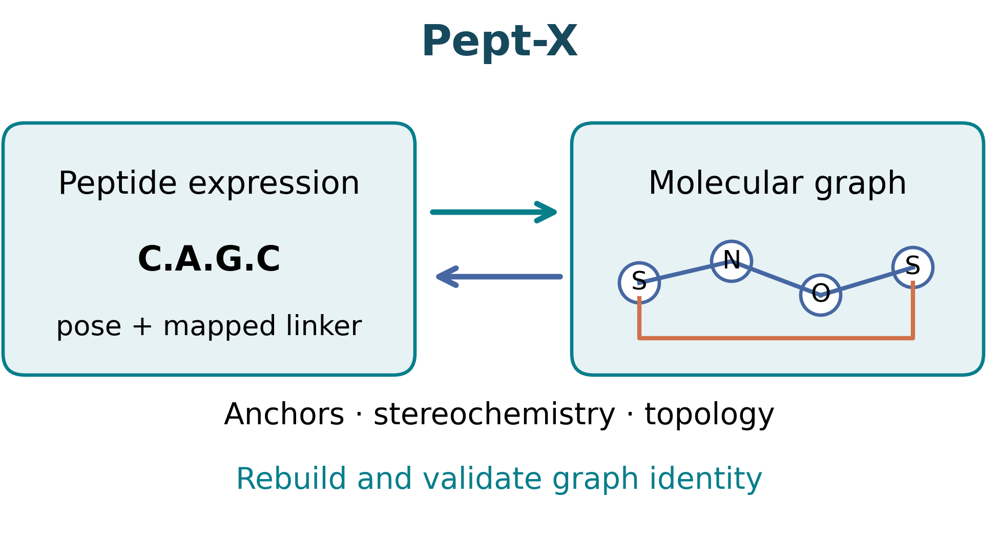
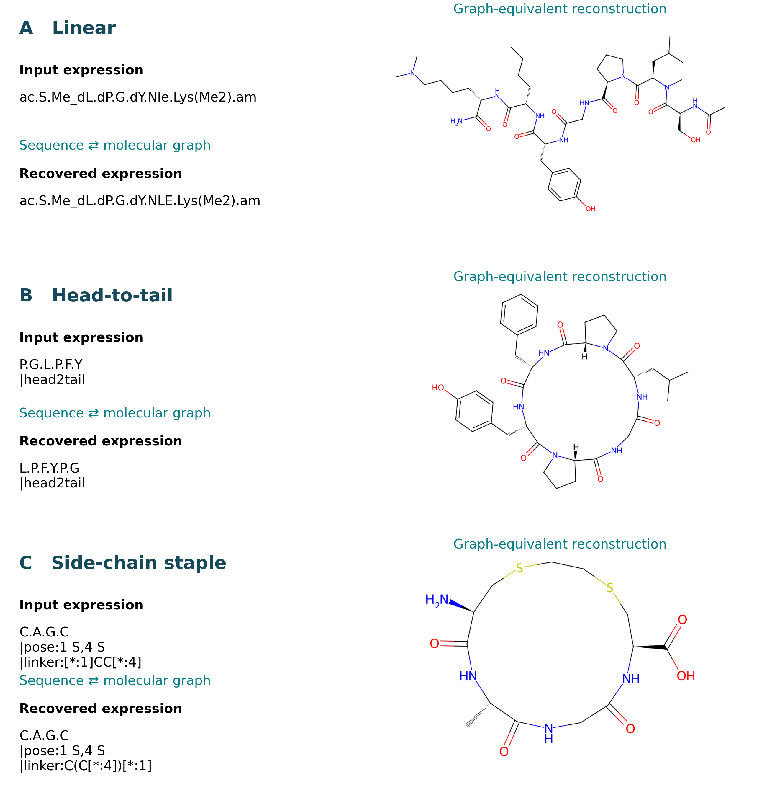
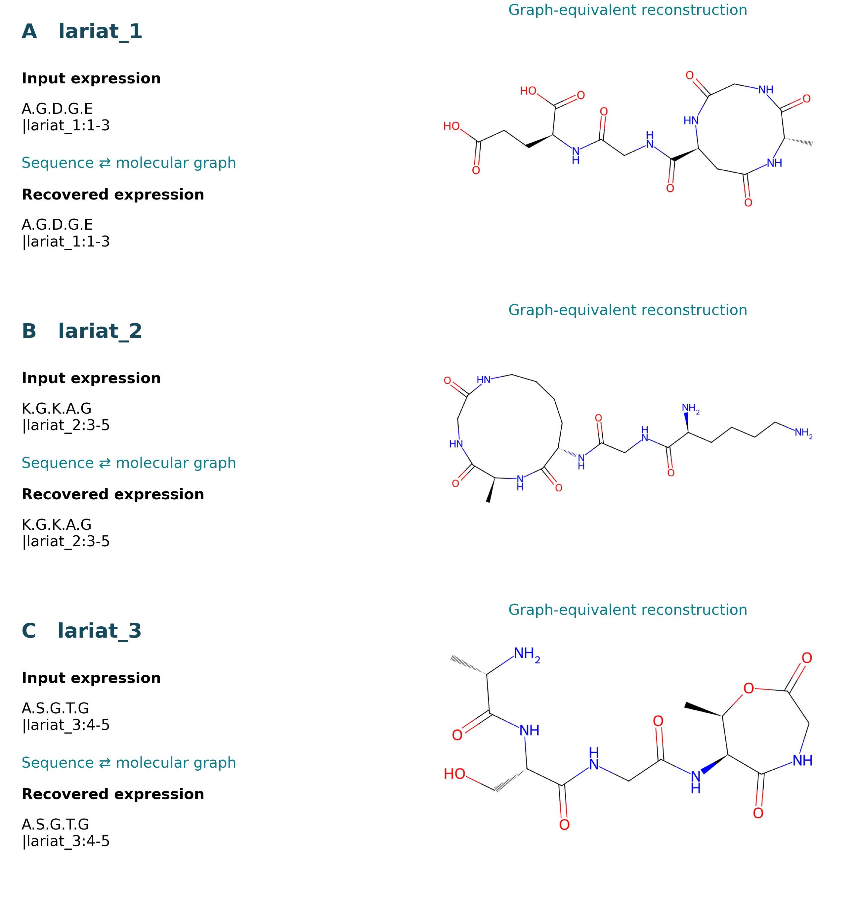

# Pept-X

Bidirectional translation between peptide sequence expressions and isomeric SMILES, with registered monomers, terminal caps, cyclic peptides, lariats and side-chain linkers. Reverse candidates are accepted by the validation interface only after graph-equivalent reconstruction.

This repository contains conversion algorithms, runtime libraries, Python/CLI interfaces, benchmark input data and representative conversion figures. Full evaluation scripts and per-record outputs accompany the manuscript.



*Schematic overview of peptide expressions, mapped attachment sites and reconstruction-based graph validation.*

## Installation

The supported environment is Python 3.11, verified with conda `py311` (Python 3.11.16, RDKit 2026.03.6):

```sh
conda activate py311
python -m pip install -r requirements.txt
```

Run the examples from the repository directory so legacy relative library paths resolve consistently.

## Linear, cyclic and disulfide peptides

```python
from seq2smi_v2 import MonomerLib
from smi2seq_v2 import SMILES2Sequence
from validated_api import compile_expression, convert_validated

library = MonomerLib("data/monomersFromHELMCoreLibrary.json")
converter = SMILES2Sequence(
    lib_path="data/monomersFromHELMCoreLibrary.json",
    load_extend=False, auto_linker_detection=False,
    allow_fingerprint_fallback=False,
)
smiles = compile_expression("ac.A.dV.G.am", library)
result = convert_validated(smiles, converter, library)
assert result["graph_equivalent"]
print(result["accepted_expression"])
```

Recommended expressions use periods between complete monomer codes:

| Chemistry | Example |
|---|---|
| Linear with terminal caps | ac.A.dV.G.am|
| Head-to-tail ring | P.G.L.P\|head2tail 
| Disulfide | `C.A.G.C\|S-S:1-4` 
| Lariat | `A.S.G.T.G\|lariat_3:4-5` |
| Side-chain linker | `C.A.G.C\|pose:1 S,4 S\|linker:[*:1]CC[*:4]` |

Hyphens within monomer names are preserved. Pept-X is not a complete HELM parser; selected HELM-like connection fields do not establish support for arbitrary HELM chemistry.

### Representative conversions



*Executed examples of a capped linear peptide containing modified and D residues (A), a head-to-tail cycle (B), and a mapped side-chain linker (C). The input and recovered expressions reconstruct equivalent molecular graphs; aliases and cyclic starting positions can differ.*

## Dedicated lariat conversion

Use the merged library that was used for the manuscript Lariat evaluation:

```python
from monomer_library import build_library
from seq2smi_lariat import build_smiles
from smi2seq_lariat import convert
from validated_api import validate_candidate

library = build_library()
smiles, forward_details = build_smiles(
    "A.S.G.T.G|lariat_3:4-5", monomer_lib=library, return_details=True)
sequence, details = convert(smiles, lib=library, list_output=True)
result = validate_candidate(smiles, sequence, details,
                            lambda expr: build_smiles(expr, monomer_lib=library))
assert result["graph_equivalent"]
print(sequence, details["lariat_positions"])
```

`build_library()` reads the core registry, `extend_lib.json`, then `extend_lib_custom.json`. These files contain 631, 624 and 71 input entries respectively; overlapping entries are not summed as distinct monomers. `build_library(include_extensions=False)` loads only core. `lariat_prepare.build_library` remains a compatibility import, without dataset-processing code. Direct lariat functions also accept an explicit `lib`/`monomer_lib`; their standalone default/`--lib` loads a single registry, so use the merged loader above for the full supported library.

Lariat positions count AA/NCAA residues from one, excluding caps:

- `lariat_1:1-j`: N-terminal backbone nitrogen to a side-chain carboxyl carbon.
- `lariat_2:i-n`: side-chain amine to the C-terminal carbonyl carbon.
- `lariat_3:i-n`: side-chain hydroxyl to the C-terminal carbonyl carbon.

Explicit positions select the requested compatible closure. Missing positions use the maximum-ring convention. Invalid explicit positions may trigger a warned fallback; inspect `explicit_positions_valid`, `fallback_used`, `fallback_reason`, `selection_rule` and `selected_lariat` when exact attachment semantics matter.

The current lariat implementation preserves mapped monomer attachment sites, cap boundaries, aromatic N-H and source functional groups, restoring only cut-bond endpoints. Where ordinary peptide traversal is insufficient, stereochemical template matches and mapped attachment boundaries provide an alternative backbone inference path. Reverse prediction receives SMILES and a library, without reference sequence, HELM or expected positions.



*Three executed lariat examples: N-terminal amine to side-chain carboxyl (A), side-chain amine to the C-terminal carbonyl (B), and side-chain hydroxyl to the C-terminal carbonyl (C). Explicit residue positions identify each closure.*

## Side-chain linkers and attachment warnings

```python
from seq2smi_v2 import MonomerLib, seq2smi
from smi2seq_v2 import SMILES2Sequence
from validated_api import convert_validated

library = MonomerLib("data/monomersFromHELMCoreLibrary.json")
smiles, details = seq2smi("C.A.G.C|linker:[*:1]CC[*:4]",
                         library, return_details=True)
print(details["warnings"], details["attachment_sites"])
converter = SMILES2Sequence(lib_path="data/monomersFromHELMCoreLibrary.json",
                           load_extend=False)
result = convert_validated(smiles, converter, library, "[*:1]CC[*:4]")
assert result["graph_equivalent"]
```

Without pose, mapped dummy labels identify one-based residue positions, excluding caps. With an explicit pose, the legacy ordinal labels 1..N in pose order are also accepted. The linker core is retained, and selected side-chain heavy atoms replace its dummy sites.

Defaults prefer compatible terminal heavy atoms with a replaceable hydrogen. Multiple candidates, missing requested elements or nonterminal fallbacks emit `AttachmentSelectionWarning` and structured records with candidate/selected template atoms. `strict_attachments=True` rejects uncertain defaults. An element preference such as `pose:1 S,4 S` cannot distinguish multiple sulfurs. `pose:1 R3,4 R3` selects existing mapped template leaving-group sites; R1/R2 remain backbone sites.

Reverse mapped hints use actual residue positions and verify complete linker boundaries and specified stereochemistry against the input graph. They activate linker recognition even when automatic detection is disabled. Incompatible hints or distinct compatible matches raise errors. Bare unmapped hints retain legacy heuristic matching. For SMILES-only automatic staple inference, construct `SMILES2Sequence(auto_linker_detection=True)` as a separate configuration; the Circle benchmark uses automatic detection disabled.

## Graph validation and CLI

```sh
python seq2smi_v2.py --input sequences.txt --output smiles.txt --lib data/monomersFromHELMCoreLibrary.json
python smi2seq_v2.py --input smiles.txt --output sequences.txt --lib data/monomersFromHELMCoreLibrary.json --details
python validated_api.py 'NCC(=O)O'
```

For a lariat SMILES, add `--lariat` to select the dedicated converter and merged registry. Dedicated lariat modules also provide batch CLI entry points. `convert()` returns `(candidate, details)` without certifying equality. `seq2smi()` normally returns a string; `return_details=True` returns `(smiles, details)`.

`validated_api.py` provides `compile_expression`, `validate_candidate` and `convert_validated`. It reports `canonical_success`, `rescued_success`, `ambiguous_decomposition`, `unsupported_chemistry`, `reconstruction_failure` or `graph_mismatch`; failed candidates have no `accepted_expression`. `molecular_graph.py` contains the same standalone parent-graph oracle used in the manuscript: atom-map removal, RDKit Cleanup, FragmentParent and canonical isomeric SMILES equality. Graph validation has no benchmark-script dependency.

This oracle distinguishes assigned from unspecified stereochemistry but does not preserve salts, aliases, atom-map provenance or synthetic history. A graph round trip does not prove a unique residue decomposition. Warnings are diagnostics, not success flags. V2 reverse inference defaults to `persist_updates=False`; loading extension libraries does not authorize cache writes. Explicit cache persistence requires `persist_updates=True`.

## Manuscript validation scope

The CSVs in [`data/`](data/README.md) are **benchmark/test input datasets** for evaluating peptide-expression ⇄ SMILES conversion: the two complete local CycPeptMPDB datasets, the fixed 18-case database lariat subset, and the 18 independent synthetic lariats. Database files retain source SMILES, sequence and HELM annotations; the smaller benchmark files also provide reference Pept-X expressions, topology classes and attachment positions. Reverse inference receives only SMILES and the monomer library; reference annotations are used for scoring and separate forward assembly.

The manuscript’s [Supporting Computational Data archive](https://zenodo.org/records/24058312), `Pept-X_Supporting_Computational_Data.zip`, records the exact evaluation code, library configurations and per-record outputs. Its `README_COMPUTATIONAL_DATA.md` provides execution commands, `TABLE_DATA_INDEX.json` maps tables to evidence, and `SHA256SUMS.json` identifies the packaged files:

| Evaluation | Forward graph | Reverse graph | Complete reverse semantics |
|---|---:|---:|---:|
| [CycPeptMPDB_Peptide_Shape_Circle.csv](data/CycPeptMPDB_Peptide_Shape_Circle.csv) | 5530/5530 | 5475/5530 | 5475/5530 |
| [CycPeptMPDB_Peptide_Shape_Lariat.csv](data/CycPeptMPDB_Peptide_Shape_Lariat.csv) | 2936/2936 | 2936/2936 | 2936/2936 |
| [Previously displayed database lariat subset](data/CycPeptMPDB_Lariat_Manuscript_Subset.csv) | 18/18 | 18/18 | 18/18 |
| [Independent synthetic lariats](data/Synthetic_Lariat_Benchmark.csv) | 18/18 | 18/18 | 18/18 |

Circle contains 5,530 records and 5,384 distinct raw SMILES; Lariat contains 2,936 records and 2,635 distinct raw SMILES. Duplicates are retained as database records. The 18-case database lariat subset and original 32 repaired failures are contained in the full Lariat dataset.

Complete reverse semantics is scored separately from graph equality. For Circle it requires residue identity, directed cyclic order modulo rotation, topology and attachment semantics. For Lariat it requires ordered residue/cap template identities, lariat type and ordered attachment positions. No closure fallback or unmatched residue occurred in the Lariat run. Lariat was a development/regression dataset; only two records are type 2. These results do not establish universal unseen-chemistry performance.

All eight independent synthetic cysteine-linker staples pass both automatic and mapped-hint graph/attachment checks. The Circle row uses the separate frozen 597-entry registry supplied at `runtime/references/circle_registry_597.json` in the Supporting Computational Data archive, with automatic linker detection and fingerprint fallback disabled. The Lariat row uses the current core + extension + custom registry described above. These configurations must be retained when reproducing the reported rates. Full evaluation scripts, fixed test inputs and detailed evidence are provided in `Pept-X_Supporting_Computational_Data.zip` at the [manuscript data record](https://zenodo.org/records/24058312). Circle/comparator scripts are under `runtime/` and `circle_comparison/`; HELM conversion evidence is under `helm_toolkit/`, with independent deposited-graph scoring under `common_parent_scoring/`. The archive identifies analysis-specific source snapshots and registries; use its manifests rather than assuming every benchmark uses the repository’s default library.

MIT license. Citation: Tang et al., *Pept-X: Reversible Translation between Peptide Sequence Expressions and Molecular Graphs* (manuscript).
